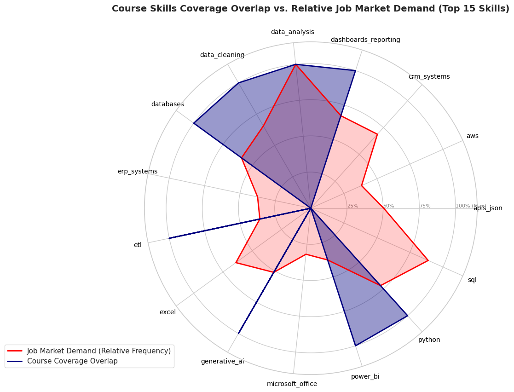
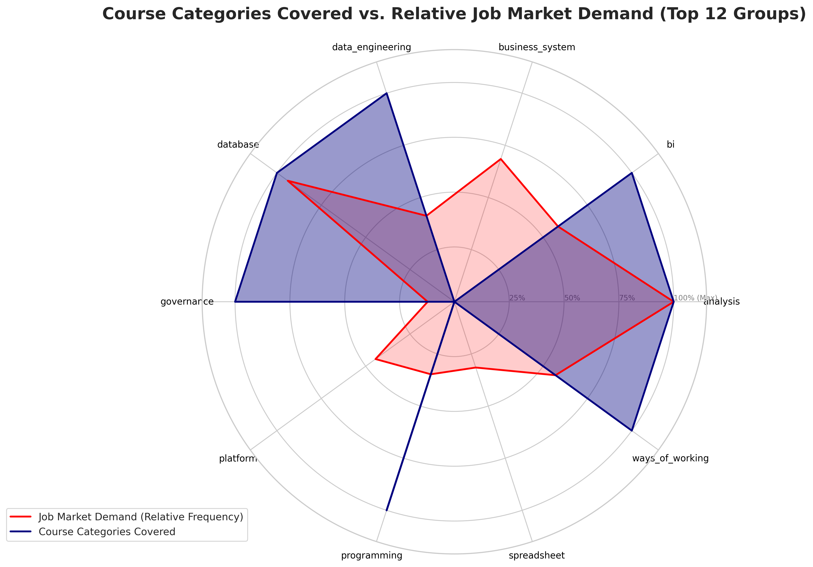
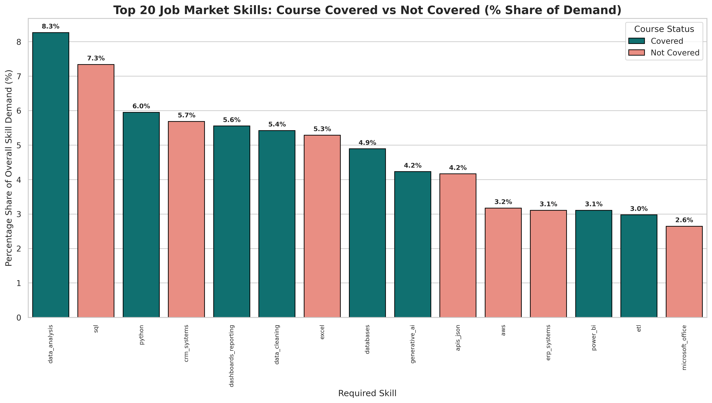
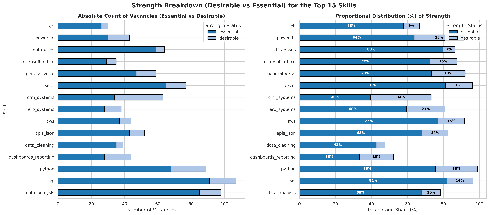
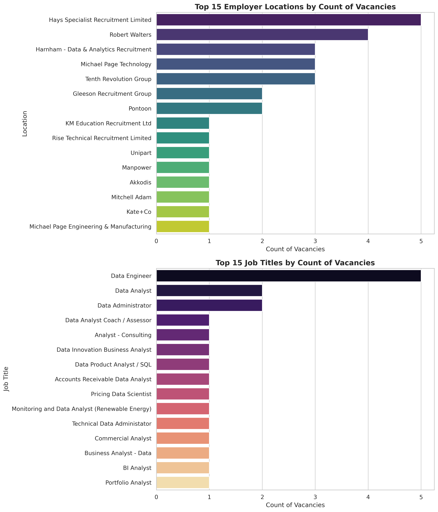
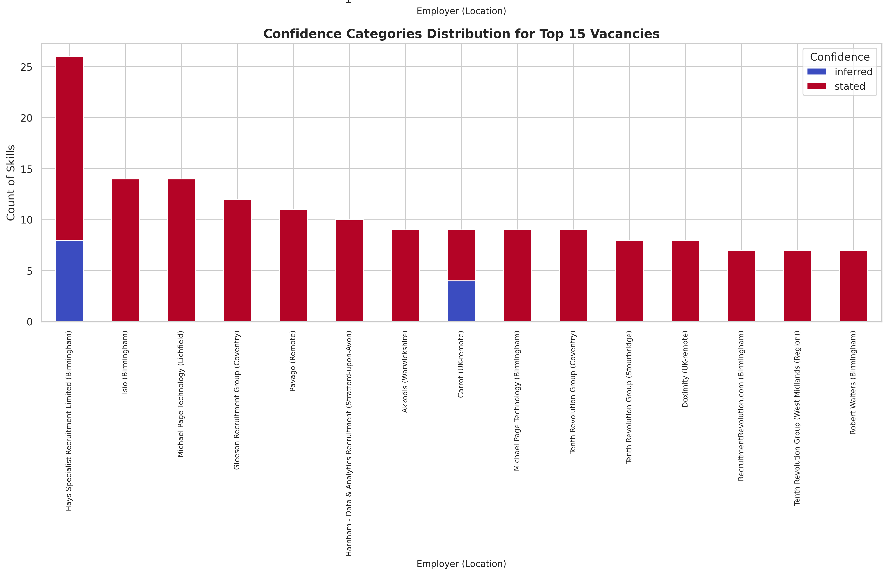
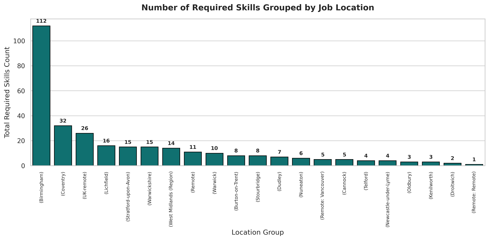

# Skills Gap Study: The course 'Diploma in Data Analytics with AI' vs the Current Job Market

**Source:** SkillMatch_Workbook.ipynb (live snapshot of 30 October 2026) · **Report date:** 31 October 2026

---

## 1. Summary

This study began with an interactive online dashboard offering a snapshot of the current job market. Live vacancy data can inform the app's design and show how well our product performs against wider market demand.

To assess how well the course aligns with employer needs, we analysed skills in real job vacancies. SkillMatch had filtered the data to non-senior, data-related roles in the Midlands, leaving 518 adverts for the skills-coverage analysis. We built SkillMatch around the course's taught skills to show how well they match market demand.

Across the adverts, employers mentioned skills 1,512 times. We mapped these mentions to a 53-skill taxonomy, with each skill flagged `course_covered` (yes/no) to indicate whether the course teaches it.

**Main findings**

- **About half of employer demand is covered.**
  Of the 1,512 skill mentions across the 518 vacancies, 741 (49%) relate to skills the course teaches.
  Only 18 of the 53 skills in the learning taxonomy (34%) are flagged as covered.
  Among the ten most requested skills, the course covers six, accounting for 60% of their total mentions. This means that while the course aligns with several high‑demand skills, a significant share of employer requirements falls outside the current curriculum.
- **The course is strong on the analytical core.** Analysis (92% of mentions covered), BI and dashboards (90%), programming (95%) and governance (100%) are well served. Python, data cleaning, dashboards, Power BI and data ethics all appear near the top of demand and are covered.
- **SQL is the biggest single gap.** It is the second most requested skill (111 mentions) and is flagged as not covered. Most employers call it essential.
- **Whole areas are missing.** Business systems (CRM, ERP, HR), cloud platforms (AWS, Azure, GCP, Databricks) and spreadsheets (Excel) have 0% coverage, and together account for 403 mentions, about 27% of demand.
- **Matching is difficult** because job titles are fragmented, recruiters dominate the listings, requirements are often unclear, and only about 1% of tracked adverts remain after filtering (see Section 4).

---

## 2. Where the course matches the market

<figure>
  
</figure>
<strong>Figure 3.</strong> Course Skills Coverage Overlap vs Relative Job Market Demand (Top 15).
  
The radar chart, _Course Skills Coverage Overlap vs. Relative Job Market Demand (Top 15 Skills)_ (Fig. 3), compares demand (red) with course coverage (navy). The strongest overlap is in `data_analysis`, `dashboards_reporting`, `data_cleaning`, `databases`, `power_bi` and `python`. The category chart (Fig. 7) shows the same pattern: coverage matches or exceeds demand in analysis, BI, governance and programming.

<figure>
  
</figure>
<strong>Figure 7.</strong> Course Categories Covered vs Relative Job Market Demand.

  

| Category         | Mentions | Covered by course |
| ---------------- | -------: | ----------------: |
| Analysis         |      279 |               92% |
| Database         |      262 |               28% |
| Business systems |      191 |                0% |
| BI               |      163 |               90% |
| Ways of working  |      159 |               58% |
| Platform (cloud) |      124 |                0% |
| Data engineering |      115 |               39% |
| Programming      |       97 |               95% |
| Spreadsheet      |       88 |                0% |
| Governance       |       34 |              100% |

_Percentages are calculated from the skill counts and taxonomy in the notebook (top-25 skills table and taxonomy output)._

Generative AI is also a strength: it is covered and ranks ninth in demand (64 mentions); the course title also highlights AI.

---

## 3. The gaps

<figure>
  
</figure>
<strong>Figure 4.</strong> Course Covered vs Not Covered (% Share of Demand).

  

### 3.1 SQL

The bar chart _Course Covered vs Not Covered_ (Fig. 4) puts SQL joint first by share of demand. It is the only top-three skill shown as not covered. The count table lists 111 SQL mentions, second only to `data_analysis` (125). The strength chart below shows that **82% of SQL mentions are "essential"**, one of the highest rates for any skill.

<figure>
  
</figure>
<strong>Figure 9.</strong> Strength Breakdown (Desirable vs Essential).

  

The SQL family extends beyond the table's SQL entry: PostgreSQL (22), T-SQL (8) and MySQL (3) bring the total to **144 mentions**. Other related uncovered skills include data modelling (24) and data warehousing (20). One vacancy title even includes SQL: "Data Product Analyst / SQL" (Fig. 6).

<figure>
  
</figure>
<strong>Figure 6.</strong> Top 15 Employers and Top 15 Job Titles by Count.

  

The taxonomy marks databases as covered (74 mentions, mostly essential) but SQL as not covered. In other words, the course teaches database concepts but not the query language employers test for. This matches the author's note that SQL was “NOT IN” the course materials.

### 3.2 Other shortages, in order of demand

1. **Excel** (80 mentions, 81% essential) and Microsoft Office (40). Surprising for a data course, but very common in analyst and "data administrator" roles.
2. **CRM and ERP systems** (86 and 47). These are tools learned on the job, but employers still list them.
3. **APIs and JSON** (63), a data-engineering skill that sits right beside the Python the course teaches.
4. **Cloud** (AWS 48, Azure 34, GCP 16, Databricks 21; 119 mentions combined), with AWS 77% essential.
5. **Business analysis** (32) and **Agile methods** (31), the working practices around the data.

### 3.3 Skills where the course is ahead of demand

pandas, NumPy and matplotlib/seaborn are taught, yet each appears in only **one** vacancy. Employers ask for "Python" and "data analysis" in general terms, rarely for specific libraries. This suggests time spent on library detail could shift towards the gaps above.

---

## 4. Why matching skills to vacancies is hard

<figure>
  
</figure>
<strong>Figure 1.</strong> Top 15 Vacancies by Number of Required Skills / Strength / Confidence.

  

1. **Job titles are fragmented.** In Fig. 6, the most common title ("Data Engineer") appears only five times, and almost every other title appears once: Data Administrator, BI Analyst, Pricing Data Scientist, Commercial Analyst and others. Searching by title alone can miss relevant roles.
2. **Recruiters dominate.** The chart labelled "Employer Locations" (Fig. 1) actually shows employers, and the top seven are recruitment agencies (Hays, Robert Walters, Harnham, Michael Page, Tenth Revolution and others). Agency adverts are often generic, and the real employer is hidden.
3. **Requirements are vague.** In Fig. 1, some vacancies have most skills tagged "unclear" rather than essential or desirable (one remote advert has all 11 marked unclear). Others rely on "inferred" rather than "stated" skills (Hays has 8 of 26). Unclear requirements make matching less reliable.
4. **Demand is concentrated by location.** Of the 307 required-skill records linked to specific locations, Birmingham accounts for 112 (36%), Coventry 32 (10%), and UK-remote 26 (8%). The figures show a strong concentration in Birmingham, while smaller areas have fewer recorded skill requirements.
5. **Skill lists are long.** One Birmingham agency advert lists 26 skills (Fig. 1). A candidate who has 60% of them may still be a reasonable match, but a strict checklist rejects them.
6. **Wording varies.** "Dataframes", "pandas" and "Python 3" may refer to related skills, but a search box may treat them as different terms. The taxonomy's `variants` lists are intended to address this.

<figure>
  
</figure>
<strong>Figure 2.</strong> Number of Required Skills Grouped by Job Location.

  

---

## 5. Recommendations

### For the course

- **Add a proper SQL module:** SELECT and filtering, joins, aggregation, subqueries and CTEs, window functions, and practice on PostgreSQL and SQL Server (T-SQL). Assess with timed query tests, as employers do.
- **Add a short Excel and Power Query unit** (lookups, pivot tables, Power Query), since Excel is both essential and common.
- **Introduce data modelling and warehousing basics** (star schema, normalisation) to connect SQL to the BI content already taught.
- **Give a cloud overview** (one platform in depth, such as AWS or Azure, plus the vocabulary of the others) and an **APIs and JSON** exercise.
- **Include business-systems awareness** (CRM, ERP) through case studies, since these cannot be installed on a laptop.
- **Trim library-level detail** where it is not requested by employers.

### For the job hunt

1. **Close SQL first.** It has the highest combination of demand and essential weighting. Practise on PostgreSQL and publish the queries on GitHub.
2. **Then Excel, then one cloud platform.** The taxonomy's `portfolio_idea` field gives a ready-made project for each skill.
3. **Search by skill, not title.** Use skill phrases (SQL, Power BI, Python) and a short list of titles: data analyst, BI analyst, data administrator, reporting analyst.
4. **Treat "essential" as the target and "desirable" as optional.** Apply when most essential skills are met, instead of waiting for a perfect match.
5. **Work with the recruiters.** They post a large share of roles, so a short, clear skills summary sent to Hays, Harnham, Michael Page and Robert Walters is efficient.
6. **Apply early.** The `first_seen` and `last_seen` fields let SkillMatch show how long an advert has been live.
7. **Improve SkillMatch itself:** show a match score weighted by essential skills, flag adverts with "unclear" requirements for manual reading, and keep running the daily snapshot so that trends appear.
