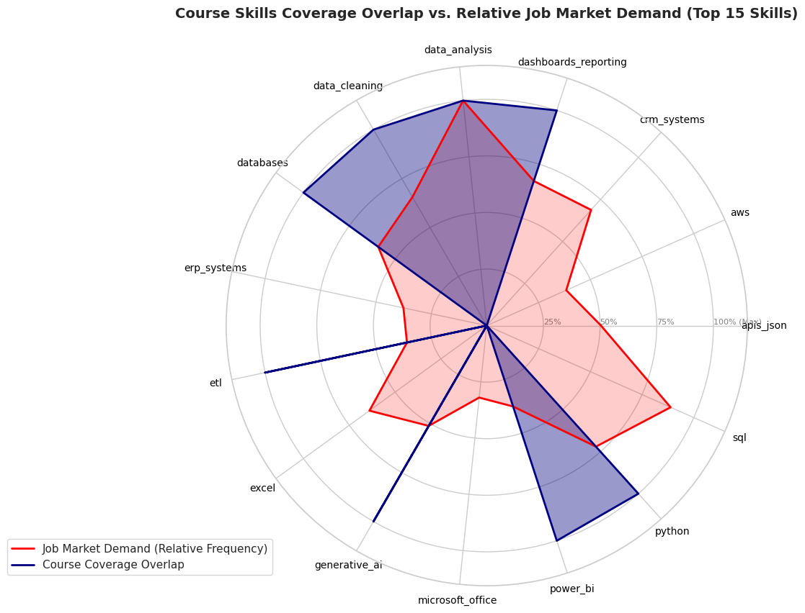
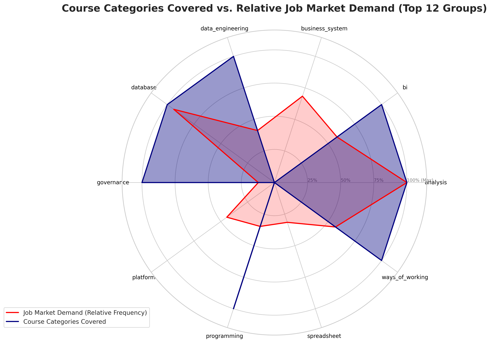
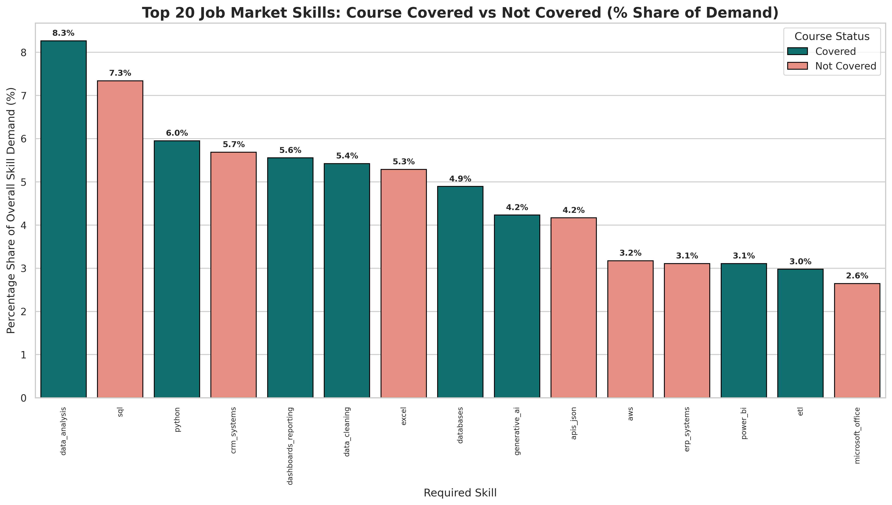
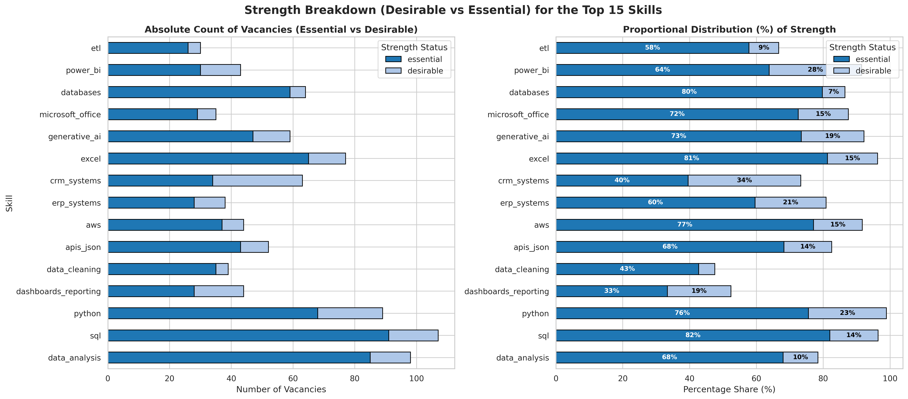
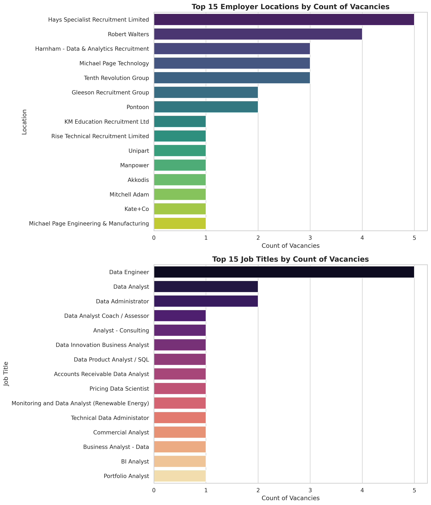
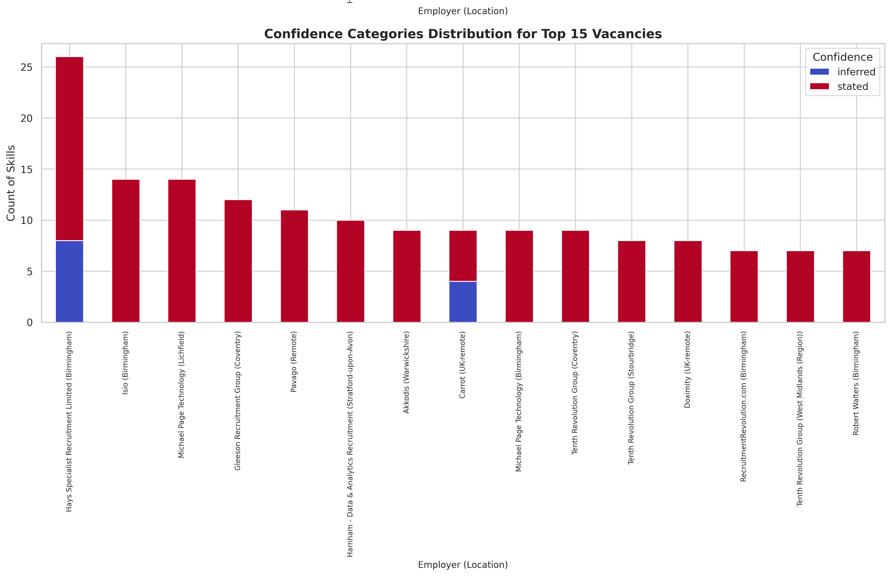
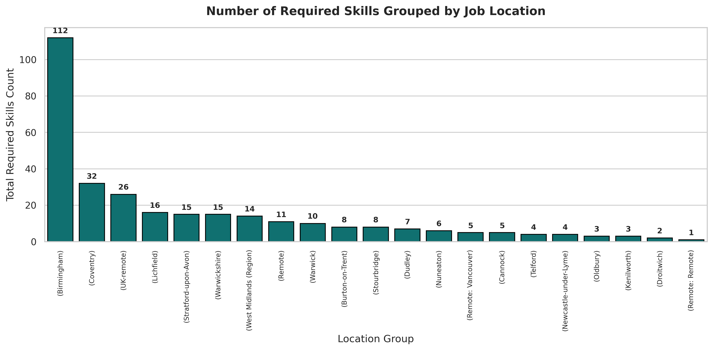
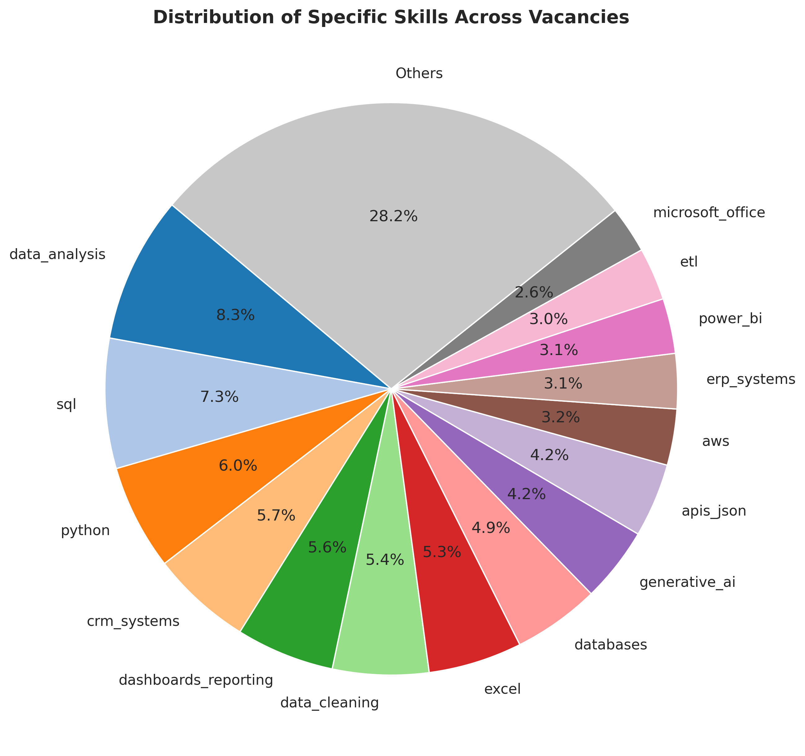

# Skills Gap Study: The course 'Diploma in Data Analytics with AI' vs the Current Job Market

**Source:** SkillMatch_Workbook.ipynb (live snapshot of 30 October 2026) · **Report date:** 31 October 2026

---

## 1. Summary

In this study I answer the question, do the skills the course teaches match the skills employers ask for? Lets compare the skills taught on the Diploma in Data Analytics with Artificial Intelligence with the skills asked for in real vacancies. The notebook holds 1,512 skill mentions extracted from job adverts, matched against a 53-skill taxonomy in which each skill is flagged `course_covered` yes or no. (A learning 'taxonomy' is a framework that breaks learning into levels, so you can see whether a course teaches basic understanding, practical skills, or deeper problem‑solving.)

**Main findings**

- **About half of employer demand is covered.** 741 of the 1,512 mentions (49%) are for skills the course covers. Only 18 of the 53 taxonomy skills (34%) are flagged as covered. Among the ten most requested skills, six are covered (60% of their mentions).
- **The course is strong on the analytical core.** Analysis (92% of mentions covered), BI and dashboards (90%), programming (95%) and governance (100%) are well served. Python, data cleaning, dashboards, Power BI and data ethics all appear near the top of demand and are covered.
- **SQL is the biggest single gap.** It is the second most requested skill (111 mentions) and is flagged as not covered. Most employers call it essential.
- **Whole areas are missing.** Business systems (CRM, ERP, HR), cloud platforms (AWS, Azure, GCP, Databricks) and spreadsheets (Excel) have 0% coverage, and together account for 403 mentions, about 27% of demand.
- **Matching is hard** because job titles are fragmented, recruiters dominate the listings, "essential" is often unclear, and only about 1% of tracked adverts survive filtering as relevant (see section 4).

---

## 2. Where the course matches the market

<figure>
  
</figure>
<strong>Figure 3.</strong> Course Skills Coverage Overlap vs Relative Job Market Demand (Top 15).
  
The radar chart _Course Skills Coverage Overlap vs. Relative Job Market Demand (Top 15 Skills)_ (Fig. 3)  shows demand (red) against course coverage (navy). The overlap is strongest around `data_analysis`, `dashboards_reporting`, `data_cleaning`, `databases`, `power_bi` and `python`. The category version (Fig. 7) shows the same pattern: coverage matches or exceeds demand in analysis, BI, governance and programming.

<figure>
  
</figure>
<strong>Figure 7.</strong> Course Categories Covered vs Relative Job Market Demand.

  

| Category         | Mentions | Covered by course |
| ---------------- | -------: | ----------------: |
| Analysis         |      279 |               92% |
| Database         |      262 |               28% |
| Business systems |      191 |                0% |
| BI               |      163 |               90% |
| Ways of working  |      159 |               58% |
| Platform (cloud) |      124 |                0% |
| Data engineering |      115 |               39% |
| Programming      |       97 |               95% |
| Spreadsheet      |       88 |                0% |
| Governance       |       34 |              100% |

_Calculated from the skill counts and taxonomy in the notebook (top-25 skills table and taxonomy output)._

Generative AI (64 mentions, covered) is a distinct strength: it is the ninth most requested skill and sits in the course's name.

---

## 3. The gaps

<figure>
  
</figure>
<strong>Figure 4.</strong> Course Covered vs Not Covered (% Share of Demand).

  

### 3.1 SQL

The bar chart _Course Covered vs Not Covered_ (Fig. 4) puts SQL joint first by share of demand, and it is the only top-three skill shown in the "Not Covered" colour. The count table lists 111 mentions, behind only `data_analysis` (125). The strength chart (below) shows that **82% of SQL mentions are "essential"**, one of the highest rates of any skill.

<figure>
  
</figure>
<strong>Figure 9.</strong> Strength Breakdown (Desirable vs Essential).

  

SQL-family skills are wider than one line in the table: PostgreSQL (22), T-SQL (8) and MySQL (3) bring the family to **144 mentions**. Related uncovered skills add more: data modelling (24) and data warehousing (20). One job title in the data even carries the skill in its name ("Data Product Analyst / SQL", below).

<figure>
  
</figure>
<strong>Figure 6.</strong> Top 15 Employers and Top 15 Job Titles by Count.

  

One nuance matters. The taxonomy marks `databases` as covered (74 mentions, 80% essential) but `sql` as not covered. So the course appears to teach database _concepts_ but not the _query language_ employers test for. This matches the author's own note in the notebook that SQL "was NOT IN" the course materials. The flag comes from the team's taxonomy file, so it should be checked against the syllabus before it is quoted externally.

### 3.2 Other shortages, in order of demand

1. **Excel** (80 mentions, 81% essential) and Microsoft Office (40). Surprising for a data course, but very common in analyst and "data administrator" roles.
2. **CRM and ERP systems** (86 and 47). These are tools learned on the job, but employers still list them.
3. **APIs and JSON** (63), a data-engineering skill that sits right beside the Python the course teaches.
4. **Cloud** (AWS 48, Azure 34, GCP 16, Databricks 21; 119 in total), with AWS 77% essential.
5. **Business analysis** (32) and **Agile methods** (31), the working practices around the data.

### 3.3 Skills where the course is ahead of demand

pandas, NumPy and matplotlib/seaborn are taught, yet each appears in only **one** vacancy. Employers ask for "Python" and "data analysis" in general terms, rarely for specific libraries. This suggests time spent on library detail could shift towards the gaps above.

---

## 4. Why matching skills to vacancies is hard

<figure>
  
</figure>
<strong>Figure 1.</strong> Top 15 Vacancies by Number of Required Skills / Strength / Confidence.

  

1. **Job titles do not help.** In Fig. 6, the most common title ("Data Engineer") appears only five times, and almost every other title appears once: Data Administrator, BI Analyst, Pricing Data Scientist, Commercial Analyst and so on. Searching by title misses relevant roles.
2. **Recruiters dominate.** The chart labelled "Employer Locations" (Fig. 1) actually shows employers, and the top seven are recruitment agencies (Hays, Robert Walters, Harnham, Michael Page, Tenth Revolution and others). Agency adverts are often generic, and the real employer is hidden.
3. **Requirements are vague.** In Fig. 1, some vacancies have most skills tagged "unclear" rather than essential or desirable (one remote advert has all 11 unclear), and others rely on "inferred" rather than "stated" skills (Hays has 8 of 26). Matching on unclear data produces weak scores.
4. **Most adverts are not for us.** The history file tracks 7,349 adverts, but only 67 were "shown" as suitable (roughly 1%). The rest are labelled things like "senior" or "not a data role". The few that remain are too few to rely on alone.
5. **Location concentrates the market.** Of 307 skill mentions in shown vacancies (Fig. 2), Birmingham has 112 (36%), Coventry 32 (10%) and UK-remote 26 (8%). A small area means a small pool.
6. **Skill lists are long.** One Birmingham agency advert lists 26 skills (Fig. 1). A candidate who has 60% of them may still be a reasonable match, but a strict checklist rejects them.
7. **Wording varies.** "Dataframes", "pandas" and "Python 3" are the same skill to a human but not to a search box. The taxonomy's `variants` lists exist to solve this.

<figure>
  
</figure>
<strong>Figure 2.</strong> Number of Required Skills Grouped by Job Location.

  

---

## 5. Recommendations

### For the course

- **Add a proper SQL module:** SELECT and filtering, joins, aggregation, subqueries and CTEs, window functions, and practice on PostgreSQL and SQL Server (T-SQL). Assess with timed query tests, as employers do.
- **Add a short Excel and Power Query unit** (lookups, pivot tables, Power Query), since Excel is both essential and common.
- **Introduce data modelling and warehousing basics** (star schema, normalisation) to connect SQL to the BI content already taught.
- **Give a cloud overview** (one platform in depth, such as AWS or Azure, plus the vocabulary of the others) and an **APIs and JSON** exercise.
- **Include business-systems awareness** (CRM, ERP) through case studies, since these cannot be installed on a laptop.
- **Trim library-level detail** where it is not requested by employers.

### For the job hunt

1. **Close SQL first.** It has the highest combination of demand and essential weighting. Practise on PostgreSQL and publish the queries on GitHub.
2. **Then Excel, then one cloud platform.** The taxonomy's `portfolio_idea` field gives a ready-made project for each skill.
3. **Search by skill, not title.** Use skill phrases (SQL, Power BI, Python) and a short list of titles: data analyst, BI analyst, data administrator, reporting analyst.
4. **Treat "essential" as the target and "desirable" as optional.** Apply when most essential skills are met, instead of waiting for a perfect match.
5. **Work with the recruiters.** They post a large share of roles, so a short, clear skills summary sent to Hays, Harnham, Michael Page and Robert Walters is efficient.
6. **Apply early.** The `first_seen` and `last_seen` fields let SkillMatch show how long an advert has been live.
7. **Improve SkillMatch itself:** show a match score weighted by essential skills, flag adverts with "unclear" requirements for manual reading, and keep running the daily snapshot so that trends appear.

---

## 6. Limits of this study

- **Short window.** The timeline chart (Fig. 8) spans only about nine days (21 to 30 October), so every top skill appears across the whole period. It cannot show a trend, only a snapshot.
- **Different bases.** The bar chart (Fig. 4) is titled "Top 20" but shows 15 skills, and its percentages (for example 10.1% for SQL) match the 307 mentions in the 67 shown vacancies, whereas the pie chart (Fig. 5) and radar (Fig. 3) use all 1,512. SQL is 7.3% of all mentions but about 10% of shown ones. Both are valid, but they should be labelled.
- **Radar charts are indicative.** Course coverage is plotted as 0 or 1, and demand as a scaled frequency, so the shaded overlap is illustrative rather than a measurement. The tables are more reliable.
- **Coverage is a team flag**, not a syllabus audit.
- **Regional, UK-focused sample** with a strong agency presence.
- **Workbook housekeeping.** An early merge joined the skills file with itself (8,188 rows) and several cells are duplicated. These should be cleaned before sharing.

<figure>
  
</figure>
<strong>Figure 5.</strong> Distribution of Specific Skills Across Vacancies (pie).

##   

## Appendix: figure index (notebook charts)

| Fig. | Chart title in notebook                                               | Used in  |
| ---- | --------------------------------------------------------------------- | -------- |
| 1    | Top 15 Vacancies by Number of Required Skills / Strength / Confidence | 4        |
| 2    | Number of Required Skills Grouped by Job Location                     | 4        |
| 3    | Course Skills Coverage Overlap vs Relative Job Market Demand (Top 15) | 2        |
| 4    | Course Covered vs Not Covered (% Share of Demand)                     | 3.1, 6   |
| 5    | Distribution of Specific Skills Across Vacancies (pie)                | 6        |
| 6    | Top 15 Employers and Top 15 Job Titles by Count                       | 3.1, 4   |
| 7    | Course Categories Covered vs Relative Job Market Demand               | 2        |
| 8    | Top 15 Skills: Active Demand Spans                                    | 6        |
| 9    | Strength Breakdown (Desirable vs Essential)                           | 3.1, 3.2 |
