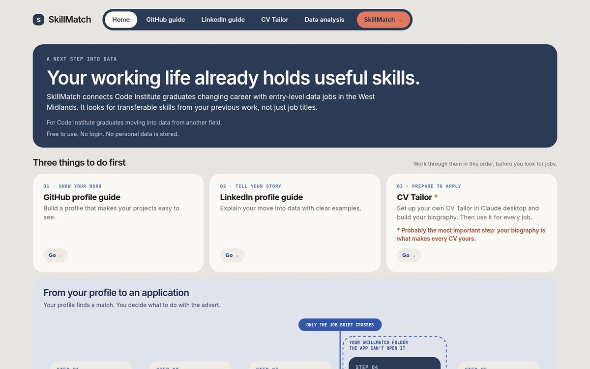
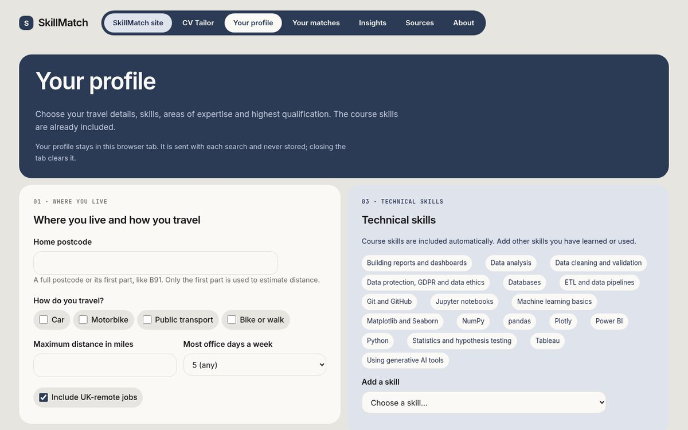
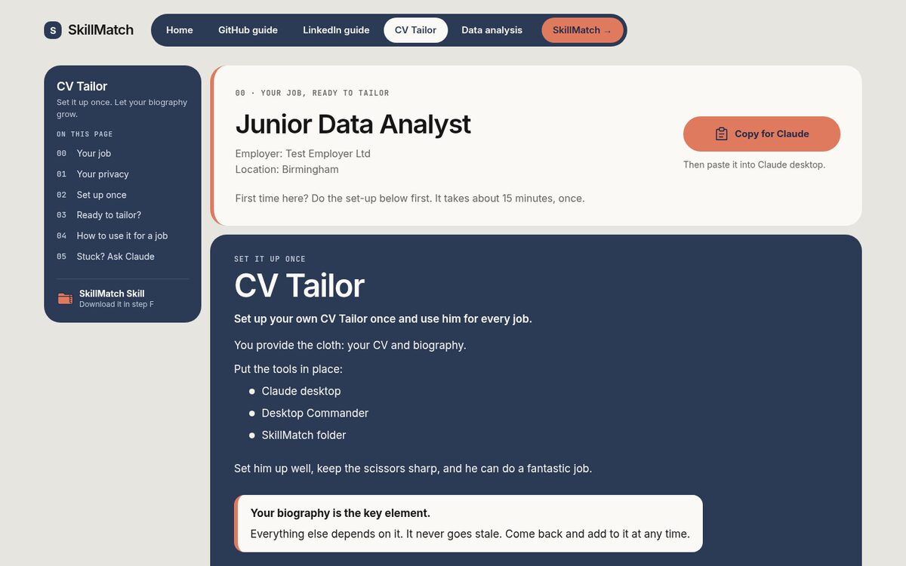
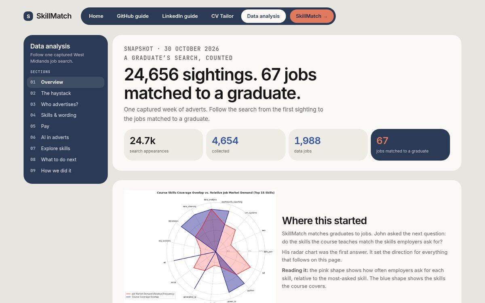
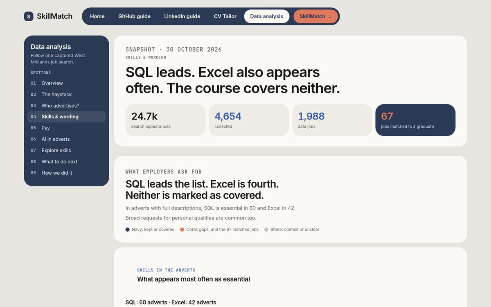
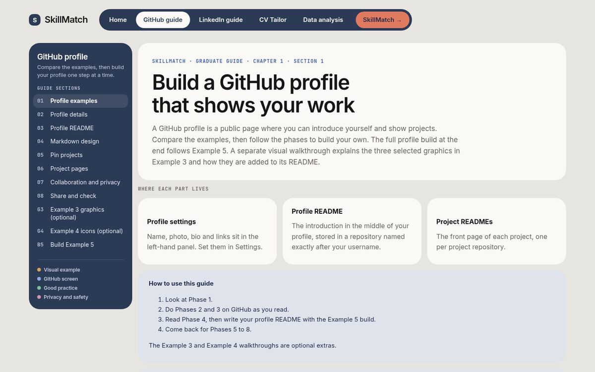

# SkillMatch

Free private job matching for Code Institute Data Analytics with AI graduates moving into data in the West Midlands.

## [Open SkillMatch](https://tidyweb.github.io/SkillMatch/)

[Try the app](https://skillmatch-926015010605.europe-west2.run.app)

## What's in it

- **Website:** start here for the project and its public pages. [Open SkillMatch](https://tidyweb.github.io/SkillMatch/)
- **Job matches:** search vacancies in the [SkillMatch app](https://skillmatch-926015010605.europe-west2.run.app).
- **GitHub guide:** make your projects easier to see on [GitHub](https://tidyweb.github.io/SkillMatch/project-visual-language/github-profile-guide/).
- **LinkedIn guide:** explain your move into data with the [LinkedIn guide](https://tidyweb.github.io/SkillMatch/project-visual-language/linkedin-profile-guide/).
- **CV Tailor:** set it up in Claude desktop with Desktop Commander, then use the SkillMatch Skill; your files stay in your own folder. [Open CV Tailor](https://tidyweb.github.io/SkillMatch/project-visual-language/tailor-my-cv/).
- **Data analysis:** explore one captured West Midlands search and its limits. [Read the analysis](https://tidyweb.github.io/SkillMatch/project-visual-language/skillmatch-da/).

## How it works

1. Open the [SkillMatch website](https://tidyweb.github.io/SkillMatch/).
2. Use the GitHub and LinkedIn guides to prepare your profiles.
3. Add your skills in the [app](https://skillmatch-926015010605.europe-west2.run.app) and search for jobs.
4. Open a job card and choose **Tailor my CV**.
5. Copy the job brief into Claude desktop, where it can be used with your CV and biography in your own SkillMatch Folder.

The job brief is carried in the page address after a `#` fragment. The app and CV Tailor page do not store it on their servers.

## Screenshots

The public site and app, captured on 31 October 2026.

Home: start with profile guides, CV Tailor and the route into job matching.

App profile: choose travel options and add skills before finding matches.

CV Tailor: a fictional job brief is ready to copy into Claude desktop.

Data analysis: follow the 30 October snapshot from search sightings to matched adverts.

Skills and wording: compare employer requests with the project's course-coverage model.

GitHub guide: build a profile that makes your projects and working skills visible.

## Privacy

- No account or login is needed.
- Your profile stays in the browser tab. The app sends it with each search and does not store it on the server.
- Your CV and biography stay in your SkillMatch Folder on your computer. The app cannot open that folder.
- The job brief contains public advert details and may include match hints based on your profile.

## How it's built

- The app uses Python and Flask and runs on Google Cloud Run.
- A daily process collects adverts from official APIs and documented feeds where collection is permitted.
- Local Python rules compare job requirements with candidate-confirmed skills. No paid AI service writes the matches.
- The static website is hosted on GitHub Pages and follows the Navy A style.
- The analysis notebook uses the local data build. Public analysis pages show summary counts; source rows stay local. See the [Jupyter notebook](skillmatch-app/notebooks/skillmatch_analysis.ipynb).

## How we built it

- Started with a four-day hackathon plan and divided the work into guides, the app, data analysis and team tasks.
- Used the [project board and issues](https://github.com/users/TidyWeb/projects/3) to track work and decisions.
- Made changes on branches and reviewed pull requests before merging them.
- Used continuous integration (CI) to check Python style, build fictional test data and run tests on pull requests.
- Automated daily vacancy collection with GitHub Actions and kept dated snapshots on the [data-snapshots branch](https://github.com/TidyWeb/SkillMatch/tree/data-snapshots/data/live_snapshots).
- Used notebooks to prepare data, compare requested skills and examine the limits of the sample.
- Exported summary data for the public analysis pages, with links back to the methods and sources.
- Published the static website on GitHub Pages and the Flask app on Google Cloud Run.

## Challenges and how we solved them

- **Source permissions** → recorded provider restrictions, kept raw advert text out of the public analysis and left CV-Library disabled. Requests for written provider approval remain open in [#7](https://github.com/TidyWeb/SkillMatch/issues/7) and [#115](https://github.com/TidyWeb/SkillMatch/issues/115).
- **A noisy search** → made duplicates and filter drops visible. The 30 October sample went from 24,656 search sightings, including repeats, to 67 matched adverts.
- **Course-coverage gaps** → marked SQL and Excel as gaps in the current model and added the “What to do next” tab with learning resources.
- **CV privacy** → kept CV and biography files on the user's computer and carried the job brief in the page address after a `#` fragment.
- **Board drift** → compared cards with merged pull requests and the work log, then recorded closure decisions. The lesson: link pull requests to the issues they finish with `Closes #<issue-number>`.
- **Layout and accessibility problems** → used screenshots and contrast audits to find problems, then fixed the profile card stretching and unreadable footer link.

## How we used AI

Claude and Codex helped with planning, code, review, analysis drafts and checks. The team chose the direction, reviewed changes and merged pull requests. AI-assisted advertiser and sentence labels are still marked as awaiting a human check on the analysis page.

CV Tailor uses the user's own Claude desktop and SkillMatch Folder. The SkillMatch app calls no paid large language model (LLM) API.

## Run it yourself

Open the project in [GitHub Codespaces](https://codespaces.new/TidyWeb/SkillMatch), then follow the setup instructions in [`skillmatch-app/README.md`](skillmatch-app/README.md).

## Project structure

| Folder | What it contains |
|---|---|
| `skillmatch-app/` | The Flask app, data collection and matching rules. |
| `project-visual-language/` | Public pages, guides and data analysis. |
| `team-guides/` | The team hub and working guides. |
| `Research/` | Vacancy source research and project resources. |
| `project-development-diary/` | Each team member's honest reflection on the project. |
| Team folders | `Phil's Folder/`, `John's Folder/`, `Rahman SK's Folder/`, `Esmat's Folder/` and `Oana's Folder/`. |

## Data and limits

The analysis uses a captured search. It shows collected adverts, not the whole job market. Reed's results were partial and some searches reached their result limit. [Read the 30 October 2026 snapshot](https://github.com/TidyWeb/SkillMatch/tree/data-snapshots/data/live_snapshots/20261030_1848) or see the [data analysis](https://tidyweb.github.io/SkillMatch/project-visual-language/skillmatch-da/).

Advertiser and sentence labels that use AI judgement are marked as awaiting a human check. The licence does not cover the job adverts collected on the `data-snapshots` branch. That content belongs to Reed and the employers who posted it.

## Hypothesis tested

We tested whether matched and senior adverts differ in how many essential requirements they list. In the full-description sample from 30 October 2026, the medians were six and five. A two-sided Mann–Whitney U test gave p = 0.062, which is not statistically significant at 0.05. This captured sample does not show a clear difference in recorded requirement counts. [Read the analysis and its limits](https://tidyweb.github.io/SkillMatch/project-visual-language/skillmatch-da/).

## Team

Built during a four-day Code Institute Data Analytics with AI hackathon in October 2026 by Esmat, John, Oana, Phil and SK.

## For the team

Team members: open the [team hub](https://tidyweb.github.io/SkillMatch/team-guides/) for guides, the project board and working documents.

## Licence

The code and written material in this repo are released under the MIT licence. See [LICENSE](LICENSE).

- Anyone can use, copy and adapt it, as long as they keep the licence notice.
- Work contributed by team members is released under the same licence.
- The licence does not cover the job adverts collected on the `data-snapshots` branch. That content belongs to Reed and the employers who posted it.
