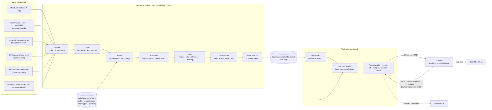
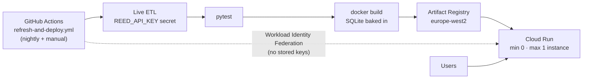

# Architecture

SkillMatch is a small, stateless Flask app over a read-only SQLite file. A batch pipeline builds the file each night from official job feeds. The app never calls an AI service and never stores a user's profile.

## Deployment

## Moving parts

| Part | Where | Notes |
|---|---|---|
| Source adapters | `skillmatch/sources/` | Each returns the same normalised `Vacancy` record. Reed filters search results before fetching details. A shared `PoliteClient` gives one request a second, a disk cache, a per-provider request cap and back-off. |
| Parser | `skillmatch/parse.py` | HTML to lines to sections to statements: essential, desirable or duty, each with stated/inferred confidence. Also extracts the data-experience demand, entry signals, degree, arrangement and office days, UK-remote eligibility and free-text salary. |
| Taxonomy | `data/taxonomy/`, `skillmatch/taxonomy.py` | Reviewable YAML, validated on load with readable errors (`python -m skillmatch.taxonomy validate`). |
| Filters | `skillmatch/filters.py`, `data/title_rules.csv` | Title filter (senior words exclude, entry words boost), relevance, training courses. Nothing is deleted: excluded adverts keep a reason. |
| Geography | `skillmatch/geo.py`, `data/town_coords.csv`, `data/outcode_coords.csv` | postcodes.io with offline fallbacks; haversine straight-line miles. |
| Matcher | `skillmatch/match.py`, `skillmatch/phrasing.py`, `skillmatch/config.py` | Per-requirement met / partly / gap, then the data-experience gate, then the tier. Thresholds live in `config.py`. |
| Results | `skillmatch/results.py` | Shortlist, filters, hidden counts and discovery links (Tier C). |
| Web | `skillmatch/web/` | Flask, Jinja, HTMX and hand-written CSS. The profile arrives with each POST and is forgotten afterwards. |
| Insights | `skillmatch/insights.py` | Aggregates for the insights page; every figure carries n. |
| Analysis | `notebooks/skillmatch_analysis.ipynb` (built by `scripts/build_notebook.py`) | Two hypothesis tests and competency demand. |

## Database tables

`vacancies` (with `excluded_reason`, `duplicate_group`, `is_primary`), `requirements` (`text_ours`, `strength`, `confidence`, `evidence_sentence`), `requirement_tags`, `sources`, `source_runs`, `duplicates`, `places`, `meta` (data mode, snapshot date).

## Design choices worth knowing

- **Stateless server.** No sessions or cookies. The profile JSON (a few KB) is posted with each results, job or insights request and dropped after the response. Requests are capped at 64 KB.
- **Read-only data.** The app opens SQLite with `mode=ro` and keeps an in-memory snapshot that reloads when the file changes.
- **The container holds only the web dependencies** (Flask, PyYAML, RapidFuzz, Gunicorn); pandas and the ETL libraries are a separate uv group. The image is about 150 MB and is ready in under a second.
- **No runtime AI.** Every explanation is a template from `phrasing.yaml` filled with the user's own words.
