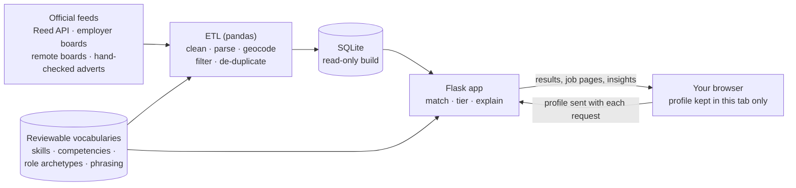

# SkillMatch

## Just opened this in Codespaces?

You don't need to do anything here. Wait for the terminal at the bottom to finish setting up (a few minutes the first time). When it says:

    Running on http://127.0.0.1:5000

hold **Ctrl** (Windows or Linux) or **Cmd** (Mac) and **click that address**. SkillMatch opens in a new tab. Ignore the other addresses it lists.

**Match the skills from your previous career to entry-level data jobs in the West Midlands.**

SkillMatch is for people finishing Code Institute's *Data Analytics with AI* course in the West Midlands. Most have a fresh qualification in Python, pandas, statistics and Power BI or Tableau, but no time yet in a data job. Most also have substantial careers behind them: PhD researchers, teachers, nurses, senior managers, plc directors, kitchen managers, retail and warehouse supervisors, people in the trades.

SkillMatch matches **people's skills, not job titles or sector history**. It turns someone's previous working life into the competencies recruiters' adverts actually ask for, adds the technical skills from the course, and finds entry-level and early-career data roles nearby. For every requirement, it shows how the person's own background answers it:

> **Requirement:** stock, inventory and supply. **Your evidence:** as a kitchen manager, you ran weekly stock and margin reports for a 40-cover restaurant and cut food waste by 15%.

No AI writes these at runtime. Matching is transparent rules over reviewable vocabularies, and there are no percentages, because a score would suggest a precision the rules don't have.

---

## Contents

- [How it works](#how-it-works)
- [Screenshots](#screenshots)
- [Run it locally](#run-it-locally)
- [Environment variables](#environment-variables)
- [Make targets](#make-targets)
- [Project layout](#project-layout)
- [Sources and attribution](#sources-and-attribution)
- [Analysis notebook](#analysis-notebook)
- [Deploying](#deploying)
- [Reviewing the taxonomy](#reviewing-the-taxonomy)
- [Limitations](#limitations)
- [Problems we hit and how we solved them](#problems-we-hit-and-how-we-solved-them)
- [Documentation](#documentation)
- [Credits and licence](#credits-and-licence)

## How it works



1. **Collect.** Each night the ETL pulls data adverts from official, free sources across the West Midlands, and links you to the many sources it can't read (see [Sources](#sources-and-attribution)).
2. **Filter, never delete.** It hides senior titles, non-data jobs, paid training courses posing as jobs, out-of-region jobs and duplicates. Each hidden advert keeps its reason, and your results say how many were hidden and let you show them.
3. **Read each advert.** Rules split it into requirement statements, sort each into essential, desirable or "describes the job", and tag them with technical skills and transferable competencies. The advert's own sentence is kept as evidence.
4. **Your profile.** Postcode (only the first part is ever used), skills rated *learned on the course*, *used in a project* or *confident*, and up to four previous roles. For each role SkillMatch suggests the competencies it usually shows; you tick the true ones and add a line of evidence. Six demo profiles let you try it straight away.
5. **Match.** Each requirement is **met**, **partly met** or **not yet**. A data-experience gate compares only explicit demands such as "2+ years as a data analyst". Adverts are grouped as **Strong fit**, **Good fit**, **Stretch** or **Not yet**, nearest first, with plain-English reasons.

The full rules are on the app's About page and in [`skillmatch/match.py`](skillmatch/match.py). The thresholds are in [`skillmatch/config.py`](skillmatch/config.py).

## Screenshots

*Placeholders: capture these from a fixtures build (`make fixtures && make run`), so no live advert data goes into the repository.*

| Page | File |
|---|---|
| Profile with a demo persona loaded | `docs/screenshots/profile.png` |
| Results grouped by fit | `docs/screenshots/results.png` |
| Job page: requirement by requirement | `docs/screenshots/job.png` |
| Insights with the map coloured by fit | `docs/screenshots/insights.png` |
| Phone width (380px) | `docs/screenshots/phone.png` |

## Run it locally

You need [uv](https://docs.astral.sh/uv/) and Python 3.12. No keys and no cloud account are needed.

```bash
make install    # uv sync: the app, the ETL and the test tools
make fixtures   # build the database from the synthetic fixture adverts
make test       # 227 tests
make run        # http://127.0.0.1:5000
```

Open the app, click a **Try a demo profile** button, then **See my matches**.

**With live data:** put your Reed Jobseeker API key in `.env` (copy `.env.example`), then:

```bash
make etl-live   # about 25–40 minutes the first time (Reed is polled about once a second); cached re-runs take seconds
make run
```

The footer badge shows which data you're looking at: *Fixtures · synthetic adverts* or *Live snapshot · date*.

## Environment variables

| Name | Needed for | Notes |
|---|---|---|
| `REED_API_KEY` | `make etl-live` | Free key from https://www.reed.co.uk/developers/jobseeker. Never logged or committed. |
| `CVLIBRARY_FEED_URL` | CV-Library jobs (optional) | Disabled until CV-Library's partner team supplies the feed. |
| `PORT` | the container | Cloud Run sets it; defaults to 8080. |
| `SKILLMATCH_ROOT` | the container | Where `data/` lives when installed as a package; the image sets `/app`. |
| `SKILLMATCH_DB` | the notebook (optional) | Path to a different database file. |

`.env` is git-ignored; `.env.example` lists the names only.

## Make targets

| Target | What it does |
|---|---|
| `make install` | Install dependencies with uv (app, ETL, dev tools) |
| `make fixtures` | Build `data/processed/skillmatch.db` from the synthetic adverts (offline) |
| `make etl-live` | Build it from the live sources (needs `REED_API_KEY`) |
| `make test` | Run pytest |
| `make lint` | Run ruff checks and the format check |
| `make run` | Serve the app on http://127.0.0.1:5000 |
| `make docker-build` | Build the image, building the database first if it's missing (fixtures if no key). `DOCKER=podman` works too. |
| `make docker-run` | Serve the image on http://localhost:8080 |

Other commands:

```bash
uv run python -m skillmatch.taxonomy validate   # check the vocabularies
uv run python -m skillmatch.curate validate     # check the hand-curated adverts
uv run python scripts/calibrate.py              # tier spread per persona, unclassified share, 20 random matches
uv run python scripts/self_check.py             # render every persona's pages and look for problems
```

## Project layout

```
skillmatch/
  sources/      one adapter per source, all returning the same Vacancy record
  etl/          pipeline, de-duplication, SQLite schema, quality report
  parse.py      advert -> requirement statements, data-experience demand, arrangement, salary
  taxonomy.py   loads and validates data/taxonomy/*.yaml
  filters.py    title, relevance and training-course filters
  geo.py        postcodes.io + offline tables, straight-line distance
  match.py      met / partly / gap, the data-experience gate, tiers
  phrasing.py   "how your background answers this" sentences
  results.py    shortlist, filters, hidden counts, discovery links
  insights.py   figures for the insights page
  web/          Flask routes, Jinja templates, CSS, a little JavaScript
data/
  taxonomy/     technical_skills, competencies, role_archetypes, phrasing (YAML, for review)
  fixtures/     synthetic adverts      curated/   hand-checked adverts (Tier B)
  personas.yaml six demo profiles      *.csv      title rules, search terms, towns, links...
tests/          pytest suite           scripts/   fixtures, calibration, self-check, notebook builders
notebooks/      skillmatch_analysis.ipynb
docs/           architecture, deploy, sources, advert patterns, taxonomy review guide
```

## Sources and attribution

SkillMatch only uses official APIs and documented feeds; it never scrapes. What each provider's documentation says is recorded in [`docs/sources.md`](docs/sources.md).

| Tier | Source | How | Credit shown |
|---|---|---|---|
| A | **Reed** Jobseeker API | Grid search of West Midlands towns; details only for jobs that pass our filters; about one request a second, cached, capped at 1,500 per run | "Jobs from Reed.co.uk", with a link to each job |
| A | **Greenhouse, Lever, Workable** employer boards | Public job-board APIs for named employers (`data/employer_boards.csv`) | Link to the employer's own posting |
| A | **We Work Remotely** RSS, **Remote OK** JSON | Data and analyst titles only; UK eligibility "unclear" unless stated | "Job via We Work Remotely" / "Job via Remote OK", followed links back |
| A | **CV-Library** affiliate feed | Disabled stub (affiliate ID 107834) until the feed URL arrives. [Register with CV-Library](https://www.cv-library.co.uk/register?id=107834). | CV-Library's own fields shown unaltered |
| B | **Hand-checked adverts** | `data/curated/adverts.csv`: facts and our own summary of requirements, no copied text | The source and date checked |
| C | **87 other sources** from the team's register | Links pre-filled with your town where the URL pattern is known; we collect nothing | — |

Postcodes and places: [postcodes.io](https://postcodes.io/). Contains OS data © Crown copyright and database right; contains Royal Mail data © Royal Mail copyright and database right; source: Office for National Statistics. Map tiles © [OpenStreetMap](https://www.openstreetmap.org/copyright) contributors. Adzuna is not used: its free key is for evaluation only.

Vacancy data is **never committed**. It lives only in the database built each night and baked into the container.

## Analysis notebook

[`notebooks/skillmatch_analysis.ipynb`](notebooks/skillmatch_analysis.ipynb) reads the SQLite build and:

- tests whether the share of entry-plausible adverts differs between the West Midlands metropolitan county and the wider region (chi-square, or Fisher's exact when expected counts are small);
- tests whether "junior/graduate/entry"-titled adverts ask for 2+ years in data as often as other adverts;
- lists the transferable competencies and technical skills that entry-plausible adverts ask for most;
- states n, the data mode and the limitations, and leaves a cell for the team's "AI-assisted interpretation: what we checked, kept and rejected".

```bash
uv sync --group notebook
uv run python scripts/build_notebook.py --execute   # or open it in Jupyter
```

## Deploying

A nightly GitHub Actions workflow ([`.github/workflows/refresh-and-deploy.yml`](.github/workflows/refresh-and-deploy.yml)) runs the live ETL with repository secrets, then runs the tests. It bakes the fresh SQLite file into a ~150 MB image (`python:3.12-slim`, gunicorn on `$PORT`) and deploys it to **Cloud Run** in `europe-west2` (minimum 0 and maximum 1 instance) through Workload Identity Federation. One-time Google Cloud setup is in [`docs/deploy.md`](docs/deploy.md), and the architecture in [`docs/architecture.md`](docs/architecture.md). A separate `ci.yml` lints and tests every push using fixtures only.

## Reviewing the taxonomy

The vocabularies in `data/taxonomy/` decide what counts as which skill or competency, so they shape every result. They are YAML files written to be reviewed by non-programmers. [`docs/taxonomy_review_guide.md`](docs/taxonomy_review_guide.md) explains how, with a worked example and the ten entries to review first. After any edit:

```bash
uv run python -m skillmatch.taxonomy validate && make test
```

## Limitations

- **Straight-line distance, not travel time.** Travel mode is collected but doesn't change results yet.
- **Partial coverage.** Only sources with an official route are collected. The live snapshot of 21 October 2026 held 2,790 adverts, of which 77 were shown as West Midlands or UK-remote data roles after filtering. Councils, the NHS, charities and many recruiters are links only.
- **Rule-based reading.** About 17% of requirement statements can't be linked to a skill or competency. They're shown but don't count. Some sentences are misread, so always read the advert.
- **"Good fit" is broad.** By design, one essential gap still counts as a Good fit, even alongside several partly-met requirements; the reasons list them.
- **The vocabularies are drafts** awaiting team review.
- **Salaries** are shown only as advertised and never estimated.
- **Reed's reuse terms** for API data aren't published. We show only short evidence sentences, link every job back, and never publish the data. The team should confirm the use with Reed before any public launch.

## Problems we hit and how we solved them

| Problem | What we did |
|---|---|
| Reed's search is very noisy: "data officer" returns payroll, HR and housing officers; "data analyst" returns finance analysts. | We studied 180 real adverts (`docs/advert_patterns.md`), then built a relevance filter and tuned it on the live snapshot. Hidden jobs are kept and countable. |
| 10% of "Trainee Data Analyst" adverts are paid training courses with a "job guarantee". They would be the top matches for our users. | Detected from their wording and hidden as "training course, not a job". |
| "Senior stakeholders" appears in 30% of adverts. | Seniority is judged on the title only. |
| The first live run spent Reed's request budget on postcode lookups. | Separate budgets per provider; the search stage uses offline postcode tables. |
| Demo personas were too thin, so a nurse "lacked" communication skills. | Personas now evidence what people in those careers really do; every expected tier change was re-derived by hand. |
| pandas turned missing values into NaN, which broke "entry-plausible" in the notebook. | Fixed at the source, with a regression test. |
| Adverts with requirements under "Ideally…" came out Strong fit on one requirement. | A Strong fit now needs at least two essentials we can check. |

The full record, with before and after numbers, is in [`DECISIONS.md`](DECISIONS.md).

## Documentation

| File | What it covers |
|---|---|
| [`docs/architecture.md`](docs/architecture.md) | Components and data flow (Mermaid) |
| [`docs/deploy.md`](docs/deploy.md) | Google Cloud and GitHub setup |
| [`docs/sources.md`](docs/sources.md) | Each provider's documentation, terms, limits and attribution |
| [`docs/advert_patterns.md`](docs/advert_patterns.md) | What 180 live adverts taught us |
| [`docs/taxonomy_review_guide.md`](docs/taxonomy_review_guide.md) | How non-technical teammates review the vocabularies |
| [`DECISIONS.md`](DECISIONS.md) | Every choice and the reason for it, including calibration numbers |
| [`PROGRESS.md`](PROGRESS.md) | Build milestones |
| [`CHANGELOG.md`](CHANGELOG.md) | Changes by version |
| [`FINAL_REPORT.md`](FINAL_REPORT.md) | What was built, verified and left open |

## Credits and licence

Built by **Tidy Web** for the Code Institute Data Analytics with AI hackathon. The demo personas are fictional people; the fixture adverts and their employers are invented.

Released under the [MIT licence](LICENSE), © 2026 Tidy Web.
